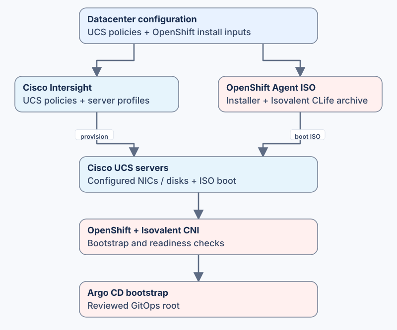

# Cisco Secure AI Compute

Provision **Cisco UCS through Cisco Intersight** and install **OpenShift with Isovalent networking from first boot**. This is the Compute layer of [Cisco Secure AI Datacenter](https://github.com/mahowlin/secure-ai-datacenter): it takes the composed hardware and installation configuration through UCS provisioning, Agent ISO generation, boot and cluster verification.

**ISO generation is also available independently**, using declared server inventory and your own media-boot process.

## Start here

| What you want to do | Where to start |
|---|---|
| Deploy UCS and OpenShift together | [Prerequisites](docs/mop/00-prerequisites.md) → [UCS/Intersight procedure](docs/mop/03-intersight-configuration.md) → [OpenShift installation](docs/mop/04-openshift-installation.md) |
| Generate an installation ISO for an existing server platform | [Declared-inventory installation procedure](agents/installation.md), including exact commands and required private files |
| Change the selected hardware, networks or software | [Customization and input ownership](docs/CUSTOMIZATION.md); change shared intent in Datacenter and import its regenerated files |
| Connect the installed cluster to GitOps | [Post-install bootstrap](docs/POST_INSTALL.md) |

## From configuration to a running cluster

1. **Receive the composition.** Datacenter generates [UCS overlays](data/ucs/) and [per-cluster installation inputs](data/openshift/). Preserve the generated artifact manifest and pristine files.
2. **Provision UCS.** Review the selected policies and profiles, plan their changes, then stage or activate them through the [UCS pipeline](.github/workflows/ucs-pipeline.yaml). Server associations, Intersight access and private state must be configured for your site.
3. **Build the installation media.** The [Agent procedure](agents/installation.md) resolves hardware, verifies the official CLife archive and prepares a private installation tree with authentication and trust. The matching OpenShift installer produces the ISO.
4. **Boot and verify.** Use the configured UCS/media-boot integration, then check [installation and cluster readiness](docs/mop/verification-procedures.md). Live hardware and cluster operations run through the configured pipelines.
5. **Hand over to GitOps.** [Bootstrap Argo CD](docs/POST_INSTALL.md) with a reviewed root from [Secure AI GitOps](https://github.com/mahowlin/secure-ai-gitops) or your own GitOps repository.

## Find the configuration

The management-cluster example shows the files used by an installation:

| Configuration | Open the file |
|---|---|
| UCS VLANs, network groups and LAN connectivity | [VLANs](data/ucs/vlan.ezi.yaml), [Ethernet Network Groups](data/ucs/ethernet_network_group.ezi.yaml), [LAN connectivity](data/ucs/lan-connectivity.ezi.yaml) |
| Cluster identity and OpenShift installation settings | [install-config.yaml](data/openshift/example-management/install-config.yaml) |
| Host NICs, addressing and Agent configuration | [agent-config.yaml](data/openshift/example-management/agent-config.yaml) |
| Selected release and installation contract | [metadata.yaml](data/openshift/example-management/metadata.yaml) |
| First-boot Isovalent configuration | [ciliumconfig.yaml](data/openshift/example-management/manifests/ciliumconfig.yaml) and [cluster network](data/openshift/example-management/manifests/cluster-network-02-config-local.yml) |

Datacenter owns these generated choices. Compute owns the [UCS execution model](ucs/), [OpenShift automation](openshift/) and private runtime enrichment. [The integration contract](docs/architecture/SAIF_INTEGRATION.md) describes that handoff; credentials and enriched installation files stay outside Git.

## GitHub Actions workflows

The workflows execute the deployment stages on your configured runner. Use **Compute Deployment** to select UCS, OpenShift or both; use the individual pipelines when you need their stage controls.

| Workflow | Role |
|---|---|
| [Compute Deployment](.github/workflows/deploy-end-to-end.yaml) | Top-level entry point. Select `ucs`, `openshift` or both, a server target and a cluster. `DRY-RUN` validates inputs and plans UCS; `DEPLOY` invokes the selected deployment workflows. |
| [UCS Pipeline](.github/workflows/ucs-pipeline.yaml) | Validates the selected server profiles, runs the requested Intersight operation and checks the resulting state. Supports Plan, Stage, Activate, Deactivate and Delete. |
| [OpenShift Pipeline](.github/workflows/openshift-pipeline.yaml) | Coordinates validation, deployment, post-install configuration and tests for a selected cluster. Each stage has its own toggle. |
| [Deploy OpenShift](.github/workflows/openshift-deploy.yaml) | Prepares private install files, generates and uploads the Agent ISO, configures UCS virtual media, boots the servers and waits for installation. Also provides file validation in dry-run mode. |
| [Post-Install Configuration](.github/workflows/openshift-post-install.yaml) | Uses private cluster access to apply bootstrap configuration and install Argo CD with the selected GitOps root. |
| [OpenShift tests](.github/workflows/openshift-test.yaml) | Checks the installed cluster after deployment or as a selected pipeline stage. |

[Runner and workflow setup](agents/operations.md#optional-site-workflows) covers the required site configuration. Configure server targets, credentials, state and trust before running a live deployment. Independent ISO generation uses the [declared-inventory procedure](agents/installation.md) and your site's boot process rather than the UCS deployment workflow.

For local checks, use [input and installation-contract validation](AGENTS.md). For deployment results, use [verification](docs/mop/verification-procedures.md) and [troubleshooting](docs/mop/troubleshooting.md). The [documentation index](docs/README.md) links the full procedures.

## License and help

See [LICENSE](LICENSE) and the shared [contribution/help guide](https://github.com/mahowlin/secure-ai-datacenter/blob/main/CONTRIBUTING.md). Entitled product archives and images are obtained separately.
